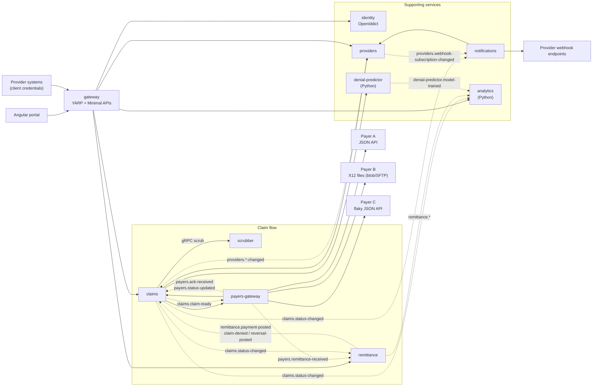

# Architecture

claim-bridge is a medical claims clearinghouse: it sits between provider organisations (clinics, practices) and insurance
payers. Providers send professional claims in; claim-bridge checks them, routes them to the right payer in that payer's
format, tracks what the payer says back, posts the money when the remittance arrives, and tells the provider about every
step. Everything in this repository runs on synthetic data and a simplified X12 subset; it is a demo, not a certified
clearinghouse.

The system is a set of small services, each owning its data, talking synchronously (REST and gRPC) where a user is
waiting for an answer and asynchronously (Kafka) for everything that happens over minutes or days.

## System overview

Solid arrows are synchronous calls (REST, or gRPC where marked). Dashed arrows are Kafka topics. The gateway is the
only entry point from outside; `/internal/*` endpoints and gRPC are only reachable inside the cluster.

## Services

| Service | Language | Store | Owns | Talks to |
|---|---|---|---|---|
| [`gateway`](../src/gateway/ClaimBridge.Gateway) | .NET 9, YARP + Minimal APIs | none | routing, token validation, per-client rate limits, claim details composition | every HTTP service |
| [`identity`](../src/services/identity/ClaimBridge.Identity) | .NET 9 | `cb_identity` | users, roles, OpenIddict clients/scopes/tokens, API client profiles | – |
| [`providers`](../src/services/providers/ClaimBridge.Providers) | .NET 9 | `cb_providers` | provider orgs, rendering providers, payer enrollments, webhook subscriptions | Kafka (publishes) |
| [`claims`](../src/services/claims/ClaimBridge.Claims) | .NET 9 | `cb_claims` + blob | claim aggregate and versions, intake, duplicates, process manager, denial worklist, appeals | scrubber (gRPC), providers, payers-gateway, denial-predictor, Kafka |
| [`scrubber`](../src/services/scrubber/ClaimBridge.Scrubber) | .NET 9 | `cb_scrubber` | code sets, built-in and payer rules, scrub results | – |
| [`payers-gateway`](../src/services/payers-gateway/ClaimBridge.PayersGateway) | .NET 9 | `cb_payers` + blob | payer adapters, X12 files, submissions, acks, status inquiries, eligibility | payers, claims, Kafka |
| [`remittance`](../src/services/remittance/ClaimBridge.Remittance) | .NET 9 | `cb_remittance` | ERA postings, reconciliation queue, A/R balances and snapshots, remittance PDFs | Kafka |
| [`notifications`](../src/services/notifications/ClaimBridge.Notifications) | .NET 9 | `cb_notifications` | webhook deliveries and attempt log, subscription health, email log | providers, provider endpoints, SMTP |
| [`denial-predictor`](../src/services/denial-predictor) | Python 3.12, FastAPI | `cb_denial_predictor` + model files | training data, model registry, prediction log | Kafka (publishes) |
| [`analytics`](../src/services/analytics) | Python 3.12, FastAPI | `cb_analytics` | claim/scrub facts, payer health samples, model events | Kafka (consumes), payers-gateway |
| [`payer-sim`](../tools/payer-sim/ClaimBridge.PayerSim) | .NET 9 | memory + blob | three mock payers (dev/test only) | payers-gateway callback, blob |

## Data ownership

Each service has its own SQL Server database and its own login, created by
[`sqlserver-init.sh`](../deploy/helm/claim-bridge/files/sqlserver-init.sh). A login is `db_owner` of its own database and has no rights
anywhere else, so a cross-service join is impossible by construction rather than by convention. In Azure the same
layout becomes one Azure SQL server with one database per service ([`infra/terraform/modules/mssql`](../infra/terraform/modules/mssql/main.tf)).

When a service needs another service's data it either asks for it over the API (claims asks providers whether an
org is enrolled, payers-gateway pulls the submission document from claims) or keeps its own projection built from
events (remittance keeps `ExpectedClaims` from `claims.status-changed`, analytics keeps `claim_facts`). The duplicated
data is always a read model that can be rebuilt from the owner.

| Data | Owner | Copies kept elsewhere |
|---|---|---|
| Patient name, member id, DOB | claims (encrypted columns) | none; payers-gateway receives it per submission over the internal API and never stores it |
| Claim status | claims | remittance (`ExpectedClaims`), analytics (`claim_facts`), notifications (only inside webhook payloads) |
| Enrollment | providers | claims (5 minute HybridCache entry) |
| Webhook subscriptions and secrets | providers (secret encrypted) | notifications (in-process cache only) |
| Payer claim ids, acks, X12 files | payers-gateway | claims keeps the payer claim id on the claim |
| Payments and adjustments | remittance | claims (paid/allowed/PR totals), analytics (facts) |
| Scrub results | scrubber | analytics (edit counts) |

## Topic catalog

Every message is a JSON envelope `{id, type, schemaVersion, occurredAt, source, correlationId, data}`
([`EventEnvelope`](../src/shared/ClaimBridge.Contracts/Events/EventEnvelope.cs)). Keys are claim ids, batch ids or file
ids; never member ids. Payloads carry no names or dates of birth. Each topic has a `.retry` lane and a `.dlq`
created by [`kafka-create-topics.sh`](../deploy/helm/claim-bridge/files/kafka-create-topics.sh).

| Topic | Producer | Consumers | Key | Payload highlights |
|---|---|---|---|---|
| `claims.batch-uploaded` | claims | claims (fan-out) | batch id | blob reference (claim check), format |
| `claims.claim-received` | claims | claims (scrub step) | claim id | claim number, payer, version |
| `claims.claim-scrubbed` | claims | claims (process manager), analytics | claim id | passed, edit rule codes, denial risk |
| `claims.claim-ready` | claims | payers-gateway | claim id | attempt number only; the document is fetched by reference |
| `claims.status-changed` | claims | notifications, analytics, remittance | claim id | from/to status, trigger, amounts, denial category |
| `payers.claim-submitted` | payers-gateway | claims | claim id | channel, file name, attempt |
| `payers.ack-received` | payers-gateway | claims | claim id | accepted, payer claim id, rejection reasons, ack type (sync, 999, 277CA) |
| `payers.status-updated` | payers-gateway | claims | claim id | 277-style status (pended, in-process, finalized + outcome) |
| `payers.remittance-received` | payers-gateway | remittance | file id | blob reference to the 835, EFT trace |
| `remittance.payment-posted` | remittance | claims, notifications, analytics | claim id | paid, allowed, PR, adjustments, partial flag |
| `remittance.claim-denied` | remittance | claims, analytics | claim id | CARC, category, RARCs |
| `remittance.reversal-posted` | remittance | claims, analytics | claim id | reversed amount |
| `providers.enrollment-changed` | providers | claims | org id | payer, new status |
| `providers.webhook-subscription-changed` | providers | notifications | org id | subscription id, change |
| `denial-predictor.model-trained` | denial-predictor | analytics | model version | AUC, Brier score, rows trained |

## Where things run

Locally everything runs in Docker Compose ([`deploy/docker-compose.yml`](../deploy/docker-compose.yml)) with SQL
Server 2022, Kafka in KRaft mode, Redis, Azurite and Jaeger. In Azure the same images run on AKS
([Helm chart](../deploy/helm/claim-bridge)), SQL Server becomes Azure SQL, Kafka becomes Event Hubs with the Kafka
endpoint, blob storage becomes a storage account plus an SFTP-enabled account for payer files. Which one a service
talks to is a setting (`Messaging:Provider`, `Storage:Provider`, `Secrets:Provider`) with the local option as the
default, so the same chart also runs on any cluster with in-cluster dependencies, and the Azure resources can come
from the optional Terraform modules or already exist. See [deployment.md](deployment.md).
