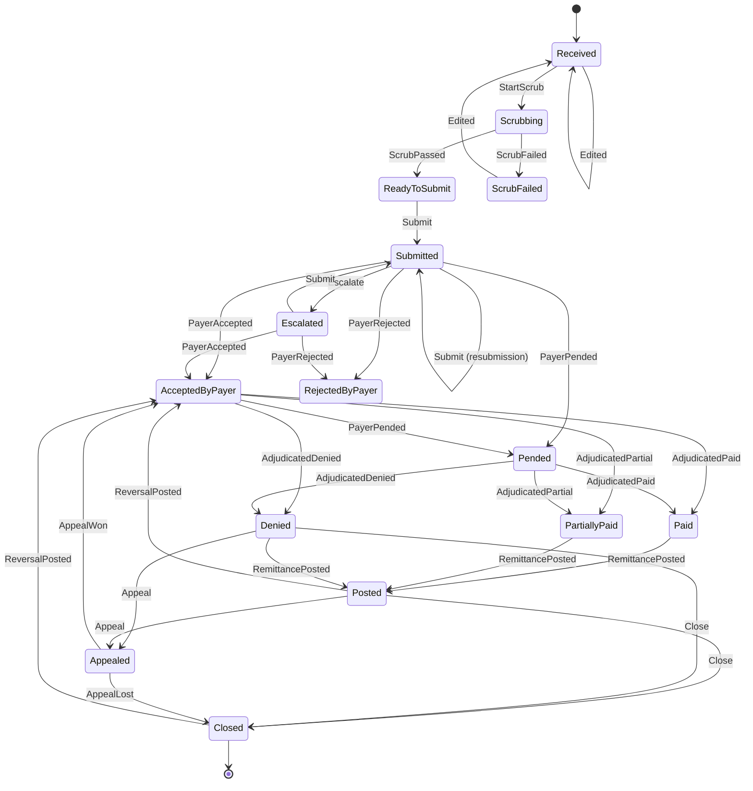

# Claim lifecycle

A claim's status is owned by the claims service and changes only through the table in
[`ClaimLifecycle`](../src/services/claims/ClaimBridge.Claims/Domain/ClaimLifecycle.cs). Every change writes a
`ClaimStatusEvent` row (from, to, trigger, source, reason, detail) next to the new status in the same transaction, and
queues `claims.status-changed` in the outbox. The history endpoint and the portal timeline read those rows; nothing
else is ever used to reconstruct a claim's past.

## State machine

`Superseded` and `Voided` are left out of the diagram to keep it readable:

- `Supersede` is fired on the original when a corrected claim (frequency code 7) is accepted for it. Allowed from
  `ScrubFailed`, `RejectedByPayer`, `Denied`, `Paid`, `PartiallyPaid`, `Posted`, `Closed` and `Appealed`.
- `Void` (frequency code 8) is allowed from every state except `Scrubbing`, `Submitted`, `Escalated`, `Appealed` and the
  two terminal states. While the payer is deciding, a void has to wait for the acknowledgement.

Both are terminal. A takeback (`ReversalPosted`) puts a paid claim back in `AcceptedByPayer` because the payer is
going to decide it again.

## Who fires what

| Trigger | Fired by | On |
|---|---|---|
| `StartScrub`, `ScrubPassed`, `ScrubFailed` | [`ScrubStepHandler`](../src/services/claims/ClaimBridge.Claims/Lifecycle/ScrubStepHandler.cs), [`ClaimProcessManager`](../src/services/claims/ClaimBridge.Claims/Lifecycle/ClaimProcessManager.cs) | `claims.claim-received`, `claims.claim-scrubbed` |
| `Edited` | `PUT /api/claims/{id}` | user edit of a claim that has not been sent |
| `Submit` | process manager | `payers.claim-submitted` |
| `PayerAccepted`, `PayerRejected` | process manager | `payers.ack-received` (sync ack, 999 rejection, 277CA) |
| `PayerPended`, `Adjudicated*` | process manager | `payers.status-updated` (Payer A callback, Payer C polling, Payer B 277) |
| `AdjudicatedPaid/Partial/Denied` (if not yet decided), `RemittancePosted`, `Close` | process manager | `remittance.payment-posted`, `remittance.claim-denied` |
| `ReversalPosted` | process manager | `remittance.reversal-posted` |
| `Escalate`, `Submit` (resubmission) | [`LifecycleTimeoutJob`](../src/services/claims/ClaimBridge.Claims/Lifecycle/LifecycleTimeoutJob.cs) | expired deadline |
| `Appeal`, `AppealWon`, `AppealLost` | [`AppealsController`](../src/services/claims/ClaimBridge.Claims/Api/AppealsController.cs) | user action, or payment after appeal |
| `Supersede`, `Void` | [`ClaimsController`](../src/services/claims/ClaimBridge.Claims/Api/ClaimsController.cs) | `POST /api/claims/{id}/correct`, `/void` |

Events can arrive out of order (a 277 status can beat the 999, a payment can arrive before the finalized status). The
process manager uses `TryFire` for the transitions that may already have happened and records a note instead of
failing: a payment on an `AcceptedByPayer` claim first fires `AdjudicatedPaid` and then `RemittancePosted`.

## Durable timeouts

Payers do not always answer. Instead of in-memory timers, the claim's `ClaimLifecycleState` row stores the next
deadline, its kind and the resubmission count. [`LifecycleTimeoutJob`](../src/services/claims/ClaimBridge.Claims/Lifecycle/LifecycleTimeoutJob.cs)
is a Quartz job that runs every 20 seconds (`Lifecycle:TimeoutScanSeconds`), picks expired deadlines and applies
[`LifecycleTimeoutPolicy`](../src/services/claims/ClaimBridge.Claims/Lifecycle/LifecycleTimeoutPolicy.cs). A restart
loses nothing; the deadline is just found on the next run.

| Deadline kind | Set when | On expiry (still `Submitted`) |
|---|---|---|
| `Acknowledgement` | claim submitted; per payer SLA (A 5 min, B 15 min, C 5 min, otherwise 10) | ask payers-gateway for a status inquiry, wait `InquiryWaitMinutes` |
| `StatusInquiry` | inquiry sent | resubmit once (`MaxResubmissions = 1`), else escalate |
| `Resubmission` | claim resubmitted | escalate to the ops worklist |

If the claim moved on in the meantime (any status other than `Submitted`) the deadline is simply cleared. Values live
under `Lifecycle` in the claims [`appsettings.json`](../src/services/claims/ClaimBridge.Claims/appsettings.json).

## Versions, corrections and voids

Claim numbers come from a SQL Server sequence and look like `CB250100123` (`CB`, two-digit year, seven digits). A
correction (`POST /api/claims/{id}/correct`) creates a new claim with its own number, `Version + 1`, frequency code `7`,
`OriginalClaimNumber` and `PreviousClaimId` set; it goes through scrub and submission like any other claim. In the
same transaction the original moves to `Superseded` and points at the replacement (`SupersededByClaimId`). A void is a
frequency `8` claim built the same way; the original moves to `Voided` and the void is sent to the payer. If the
original is in a state that cannot be superseded or voided (the payer is still deciding), intake answers `409` and
asks the user to wait for the decision.

Rules `CB011` and `CB013` in the scrubber enforce the shape of these claims: a new claim that looks like an existing one
is flagged as a duplicate, and frequency 7/8 claims must carry the original claim number.

## Optimistic concurrency

`Claim.RowVersion` is a SQL Server `rowversion`. Two handlers racing on the same claim (for example the 999 consumer
and a user edit) cannot both commit; the loser gets a `DbUpdateConcurrencyException`. A consumer that loses sends the message to its
`.retry` lane and handles it again against the fresh claim; a user request that loses fails and can be repeated.
