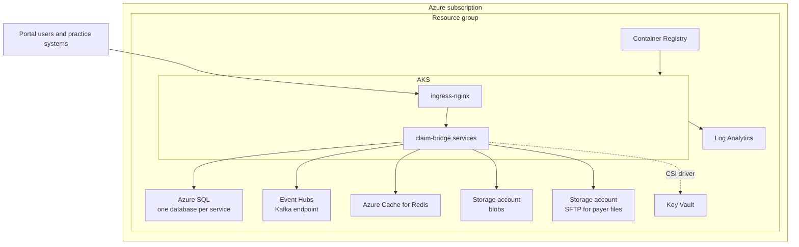

# Deployment

The target is Azure: AKS for the services, Azure SQL, Event Hubs (Kafka endpoint), Azure Cache for Redis, Storage
and Key Vault, all created with Terraform and deployed with Helm from Azure DevOps. Nothing in this repository has been
applied to a real subscription; every id is a placeholder (`00000000-0000-0000-0000-000000000000`) and the remote
state backend is a stub.



## Terraform

Layout under [`infra/terraform`](../infra/terraform):

| Path | Creates |
|---|---|
| [`modules/log-analytics`](../infra/terraform/modules/log-analytics/main.tf) | workspace for AKS and diagnostics |
| [`modules/acr`](../infra/terraform/modules/acr/main.tf) | container registry, pull rights for the AKS kubelet identity |
| [`modules/aks`](../infra/terraform/modules/aks/main.tf) | AKS with Entra ID RBAC, an autoscaling node pool, Azure CNI with Azure network policy, workload identity and the Key Vault CSI driver |
| [`modules/mssql`](../infra/terraform/modules/mssql/main.tf) | SQL server with Entra-only authentication and one database per service |
| [`modules/eventhubs`](../infra/terraform/modules/eventhubs/main.tf) | namespace with one event hub per topic plus `.retry` and `.dlq` |
| [`modules/redis`](../infra/terraform/modules/redis/main.tf) | Redis cache, TLS only |
| [`modules/storage`](../infra/terraform/modules/storage/main.tf) | blob account, and an SFTP-enabled account with one local user per payer |
| [`modules/keyvault`](../infra/terraform/modules/keyvault/main.tf) | Key Vault with RBAC, purge protection and a rotation policy for keys |
| [`envs/dev`](../infra/terraform/envs/dev/main.tf), [`envs/prod`](../infra/terraform/envs/prod/main.tf) | one root module per environment wiring the modules together |

Provider versions are locked (`azurerm` 4.40.0, `.terraform.lock.hcl` committed); Terraform itself must be 1.11 to
1.13. To check the configuration without touching Azure:

```bash
cd infra/terraform/envs/dev
terraform init -backend=false
terraform validate
```

Real values go in a `terraform.tfvars` copied from
[`terraform.tfvars.example`](../infra/terraform/envs/prod/terraform.tfvars.example); that file is git-ignored. CI
supplies them from the `claim-bridge-common` variable group and a secure file with the payer SFTP public keys, and
passes the real backend with `-backend-config`.

## Helm

The chart in [`deploy/helm/claim-bridge`](../deploy/helm/claim-bridge) renders every service from one `services`
map in [`values.yaml`](../deploy/helm/claim-bridge/values.yaml), with
[`values-dev.yaml`](../deploy/helm/claim-bridge/values-dev.yaml) and
[`values-prod.yaml`](../deploy/helm/claim-bridge/values-prod.yaml) layered on top.

| Template | What |
|---|---|
| `deployment.yaml`, `service.yaml` | one Deployment and Service per enabled service; non-root, read-only root filesystem, dropped capabilities, `/alive` liveness and `/health` readiness probes |
| `configmap.yaml`, `secret.yaml` | non-secret settings; the secret is rendered only when no `existingSecret` is given, with `REPLACE_ME` placeholders |
| `hpa.yaml`, `pdb.yaml` | autoscaling for claims, scrubber and notifications; a disruption budget for anything with more than one replica |
| `networkpolicy.yaml` | default deny; ingress to gateway and portal only from the ingress controller; in-namespace traffic; egress to Azure PaaS; external egress only for notifications and payers-gateway |
| `ingress.yaml` | `/` to the portal, `/api`, `/connect`, `/.well-known`, `/account` to the gateway |
| `cronjobs.yaml` | weekly model retraining and the nightly A/R snapshot, both calling internal endpoints |
| `pvc.yaml` | volume for trained model files |

Before the first install, create two secrets in the namespace (normally synced from Key Vault by the CSI driver):

- `claim-bridge-secrets` with connection strings, the PHI key and the payer callback token (keys listed in
  `secret.yaml`);
- `claim-bridge-identity-keys` with `signing.pfx`, `encryption.pfx` and `password`, so every identity replica signs
  tokens with the same key.

Then:

```bash
helm upgrade --install claim-bridge deploy/helm/claim-bridge \
  -n claim-bridge --create-namespace \
  -f deploy/helm/claim-bridge/values-prod.yaml \
  --set global.imageTag=1.0.42
```

`helm lint` and `helm template` with both values files run in CI. The dev values enable the payer simulator, keep one
replica of most services and let identity use ephemeral keys; the prod values disable the simulator and expect the
pre-created secrets.

Migrations run on service start with a retry loop (EF Core for .NET, Alembic for Python). Each migration is written to
be safe while the previous version is still running, so a rolling update needs no separate migration job.

## Azure DevOps pipeline

[`azure-pipelines.yml`](../azure-pipelines.yml) with templates in [`deploy/pipelines/templates`](../deploy/pipelines/templates):

| Stage | What | When |
|---|---|---|
| Build & Test | detects which areas changed, then .NET build and test (with Testcontainers), Python tests, portal tests | every PR and push |
| Security scan | gitleaks, `dotnet list package --vulnerable`, `pip-audit`, `npm audit` | every PR and push |
| Images | builds and pushes changed images to ACR, tagged with the build number | `main` only |
| Infra plan | `terraform validate` and `plan` for dev and prod; the plan is published as an artifact | `main` only |
| Deploy Dev | `helm upgrade --install` with the dev values | after Images and Infra plan |
| Smoke test | gateway liveness, OpenID discovery and the portal answer 200; a client-credentials token works against `/api/gateway/me` | after Deploy Dev |
| Deploy Prod | same chart with prod values | after the smoke test and a manual approval on the `claim-bridge-prod` environment |

Applying Terraform is deliberately not automatic: someone reviews the published plan and applies it.

## Production checklist

- Replace placeholder ids in the tfvars and the pipeline variable group; configure the remote state backend.
- Load the identity signing and encryption certificates and the PHI key into Key Vault; rotate the PHI key with a new
  `v2:` prefix rather than re-encrypting in place.
- Point `global.publicIssuer` and the ingress host at the real domain and set `ingress.tls.secretName` to a
  certificate (for example from cert-manager).
- Replace the simulator with the real payer endpoints and credentials, one payer at a time.
- Turn on `Telemetry:ExportMetrics` and point `OTEL_EXPORTER_OTLP_ENDPOINT` at a collector that forwards to Azure
  Monitor.
- Review the two pinned packages with known advisories listed under
  [security and auth](security-and-auth.md#known-gaps).
