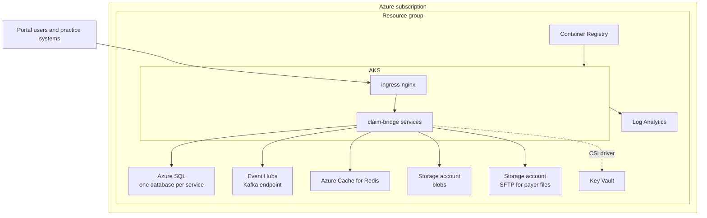

# Deployment

claim-bridge runs in three places, and Terraform is only one of the ways to get there:

| Where | Dependencies | Terraform |
|---|---|---|
| Docker Compose on a laptop | SQL Server, Kafka, Redis, Azurite, MailHog containers | not involved |
| Any Kubernetes cluster (Docker Desktop, kind) with [`values-local.yaml`](../deploy/helm/claim-bridge/values-local.yaml) | the same containers, run by the chart | not involved |
| AKS with [`values-dev.yaml`](../deploy/helm/claim-bridge/values-dev.yaml) or [`values-prod.yaml`](../deploy/helm/claim-bridge/values-prod.yaml) | Azure SQL, Event Hubs, Azure Cache for Redis, Storage (with SFTP), Key Vault | optional: [`infra/terraform`](../infra/terraform) can create them, or they already exist |

Nothing in the application knows about Terraform. Each Azure-only integration sits behind a setting whose default is
the local option, and the chart sets the Azure option only where Azure is the target. Nothing in this repository has
been applied to a real subscription; every id is a placeholder (`00000000-0000-0000-0000-000000000000`) and the
remote state backend is a stub.

## Provider settings

| Setting (.NET / Python) | Local (default) | Azure | Chart value |
|---|---|---|---|
| `Messaging:Provider` / `MESSAGING_PROVIDER` | `kafka`: plain Kafka at `Kafka:BootstrapServers` | `eventhubs`: the Event Hubs Kafka endpoint, SASL with `ConnectionStrings:EventHubs` | `providers.messaging` |
| `Storage:Provider` / `STORAGE_PROVIDER` | `local`: `ConnectionStrings:Blob`, falling back to Azurite | `azure`: a real storage account; Azurite is refused | `providers.storage` |
| `Secrets:Provider` / `SECRETS_PROVIDER` | `local`: environment variables (from `.env` or a Kubernetes Secret); `Phi:KeyFile` may name a key file | `keyvault`: files mounted by the Key Vault CSI driver at `/mnt/secrets-store` | `providers.secrets` (`kubernetes` or `keyvault`) |

The switches live in [`SecretsConfiguration`](../src/shared/ClaimBridge.ServiceDefaults/Configuration/SecretsConfiguration.cs),
[`KafkaOptions`](../src/shared/ClaimBridge.ServiceDefaults/Messaging/KafkaOptions.cs) and
[`BlobStore`](../src/shared/ClaimBridge.ServiceDefaults/Storage/BlobStore.cs) for .NET, and in each Python service's
`app/config.py`. An unknown value, or the Azure option without its connection string, stops the service at start
rather than failing on the first request.

## Kubernetes without Azure

[`values-local.yaml`](../deploy/helm/claim-bridge/values-local.yaml) uses the images built by Compose
(`claim-bridge/<service>:local`), runs SQL Server, Kafka, Redis, Azurite and MailHog in the cluster
([`local-dependencies.yaml`](../deploy/helm/claim-bridge/templates/local-dependencies.yaml)), creates the databases
and topics with the same scripts Compose uses (`files/`), and keeps secrets in a Kubernetes Secret. The PHI key is
read from a git-ignored file:

```bash
docker compose build
mkdir -p .local && openssl rand -base64 32 > .local/phi.key
helm upgrade --install claim-bridge deploy/helm/claim-bridge -n claim-bridge --create-namespace \
  -f deploy/helm/claim-bridge/values-local.yaml --set-file localSecrets.phiKey=.local/phi.key
kubectl -n claim-bridge port-forward svc/claim-bridge-gateway 5080:8080
kubectl -n claim-bridge port-forward svc/claim-bridge-portal 4200:8080
```

Docker Desktop's Kubernetes sees the local images directly; with kind, load them first (`kind load docker-image`).
Dependency data lives in `emptyDir` volumes, so it is gone when those pods restart. The historical seed and the e2e
scenarios are Compose tools; on this path the services seed their reference data and demo users only.

## Azure without Terraform

When the resources already exist (created in the portal, by a platform team, or by an earlier Terraform run), the
chart only needs their names and ids:

| Value | What |
|---|---|
| `config.kafkaBootstrap`, `config.redisHost`, `config.sqlServer` | Event Hubs namespace (`<name>.servicebus.windows.net:9093`), Redis host, SQL server FQDN |
| `keyVault.name`, `keyVault.tenantId`, `keyVault.identityClientId` | the vault and the client id of the AKS Key Vault secrets provider identity |
| `global.imageRegistry` | the container registry |

In the pipeline the ids come from the `claim-bridge-common` variable group (`tenantId`, `keyVaultIdentityClientId`,
`acrLoginServer`, `aksResourceGroup`, `aksClusterName`), and the Terraform stage stays off. The Key Vault must hold
one secret per entry in the chart's secret list, named as in the Kubernetes Secret (`claims-connection-string`,
`redis-connection-string`, `blob-connection-string`, `phi-key`, `eventhubs-connection-string`,
`payer-a-callback-token`, `<service>-database-url` for the Python services). Each pod mounts only its own entries
through a per-service `SecretProviderClass`. Azure SQL in the Terraform module accepts Entra ID authentication only,
so the stored connection strings use `Authentication=Active Directory Managed Identity` rather than passwords.



## Terraform (optional)

Terraform is one way to create the Azure resources above. Its outputs (`key_vault_name`,
`key_vault_identity_client_id`, `kafka_bootstrap`, `redis_hostname`, `sql_server_fqdn`, `acr_login_server`) are
exactly the values the chart needs, so moving from "Terraform created it" to "it already existed" changes nothing in
the chart or the code. Layout under [`infra/terraform`](../infra/terraform):

| Path | Creates |
|---|---|
| [`modules/log-analytics`](../infra/terraform/modules/log-analytics/main.tf) | workspace for AKS and diagnostics |
| [`modules/acr`](../infra/terraform/modules/acr/main.tf) | container registry, pull rights for the AKS kubelet identity |
| [`modules/aks`](../infra/terraform/modules/aks/main.tf) | AKS with Entra ID RBAC, an autoscaling node pool, Azure CNI with Azure network policy, workload identity and the Key Vault CSI driver |
| [`modules/mssql`](../infra/terraform/modules/mssql/main.tf) | SQL server with Entra-only authentication and one database per service |
| [`modules/eventhubs`](../infra/terraform/modules/eventhubs/main.tf) | namespace with one event hub per topic plus `.retry` and `.dlq` |
| [`modules/redis`](../infra/terraform/modules/redis/main.tf) | Redis cache, TLS only |
| [`modules/storage`](../infra/terraform/modules/storage/main.tf) | blob account, and an SFTP-enabled account with one local user per payer |
| [`modules/keyvault`](../infra/terraform/modules/keyvault/main.tf) | Key Vault with RBAC, purge protection and a rotation policy for keys |
| [`envs/dev`](../infra/terraform/envs/dev/main.tf), [`envs/prod`](../infra/terraform/envs/prod/main.tf) | one root module per environment wiring the modules together |

Provider versions are locked (`azurerm` 4.40.0, `.terraform.lock.hcl` committed); Terraform itself must be 1.11 to
1.13. To check the configuration without touching Azure:

```bash
cd infra/terraform/envs/dev
terraform init -backend=false
terraform validate
```

Real values go in a `terraform.tfvars` copied from
[`terraform.tfvars.example`](../infra/terraform/envs/prod/terraform.tfvars.example); that file is git-ignored. CI
supplies them from the `claim-bridge-common` variable group and a secure file with the payer SFTP public keys, and
passes the real backend with `-backend-config`.

## Helm

The chart in [`deploy/helm/claim-bridge`](../deploy/helm/claim-bridge) renders every service from one `services`
map in [`values.yaml`](../deploy/helm/claim-bridge/values.yaml), with
[`values-dev.yaml`](../deploy/helm/claim-bridge/values-dev.yaml),
[`values-prod.yaml`](../deploy/helm/claim-bridge/values-prod.yaml) or
[`values-local.yaml`](../deploy/helm/claim-bridge/values-local.yaml) layered on top.

| Template | What |
|---|---|
| `deployment.yaml`, `service.yaml` | one Deployment and Service per enabled service; non-root, read-only root filesystem, dropped capabilities, `/alive` liveness and `/health` readiness probes |
| `configmap.yaml` | non-secret settings, including the three provider switches |
| `secret.yaml` | with the `kubernetes` secrets provider and no `existingSecret`: local development values, or `REPLACE_ME` placeholders |
| `secretproviderclass.yaml` | with the `keyvault` secrets provider: one Key Vault CSI class per service, listing only that service's secrets |
| `local-dependencies.yaml` | with `localDependencies.enabled`: SQL Server, Kafka, Redis, Azurite, MailHog and the init jobs |
| `hpa.yaml`, `pdb.yaml` | autoscaling for claims, scrubber and notifications; a disruption budget for anything with more than one replica |
| `networkpolicy.yaml` | default deny; ingress to gateway and portal only from the ingress controller; in-namespace traffic; egress to Azure PaaS; external egress only for notifications and payers-gateway |
| `ingress.yaml` | `/` to the portal, `/api`, `/connect`, `/.well-known`, `/account` to the gateway |
| `cronjobs.yaml` | weekly model retraining and the nightly A/R snapshot, both calling internal endpoints |
| `pvc.yaml` | volume for trained model files |

`service.yaml` also adds a `gateway` alias, because the portal image's nginx proxies `/api` to that host name, as in
Compose.

Before the first install on AKS, load the application secrets into Key Vault (see above) and create
`claim-bridge-identity-keys` in the namespace with `signing.pfx`, `encryption.pfx` and `password`, so every identity
replica signs tokens with the same key. Then:

```bash
helm upgrade --install claim-bridge deploy/helm/claim-bridge \
  -n claim-bridge --create-namespace \
  -f deploy/helm/claim-bridge/values-prod.yaml \
  --set global.imageTag=1.0.42
```

CI runs `helm lint` and `helm template` with all three values files. The dev values enable the payer simulator and
seeding, keep one replica of most services and let identity use ephemeral keys; the prod values disable the
simulator.

Migrations run on service start with a retry loop (EF Core for .NET, Alembic for Python). Each migration is written to
be safe while the previous version is still running, so a rolling update needs no separate migration job.

## Azure DevOps pipeline

[`azure-pipelines.yml`](../azure-pipelines.yml) with templates in [`deploy/pipelines/templates`](../deploy/pipelines/templates):

| Stage | What | When |
|---|---|---|
| Build & Test | detects which areas changed, then .NET build and test (with Testcontainers), Python tests, portal tests, Helm lint and template for dev, prod and local | every PR and push |
| Security scan | gitleaks, `dotnet list package --vulnerable`, `pip-audit`, `npm audit` | every PR and push |
| Images | builds and pushes changed images to ACR, tagged with the build number | `main` only |
| Infra plan | `terraform validate` and `plan` for dev and prod; the plan is published as an artifact | `main`, and only when the `provisionInfra` parameter is `true` (default `false`) |
| Deploy Dev | `helm upgrade --install` with the dev values | after Images (and Infra plan when it runs) |
| Smoke test | gateway liveness, OpenID discovery and the portal answer 200; a client-credentials token works against `/api/gateway/me` | after Deploy Dev |
| Deploy Prod | same chart with prod values | after the smoke test and a manual approval on the `claim-bridge-prod` environment |

Applying Terraform is deliberately not automatic: someone reviews the published plan and applies it. With
`provisionInfra` off, the stage is not even in the run, and deployment works against whatever resources the variable
group and values files name.

## Production checklist

- Replace placeholder ids in the values files and the pipeline variable group (and, if Terraform is used, in the
  tfvars and the remote state backend).
- Load the identity signing and encryption certificates and the PHI key into Key Vault; rotate the PHI key with a new
  `v2:` prefix rather than re-encrypting in place.
- Point `global.publicIssuer` and the ingress host at the real domain and set `ingress.tls.secretName` to a
  certificate (for example from cert-manager).
- Replace the simulator with the real payer endpoints and credentials, one payer at a time.
- Turn on `Telemetry:ExportMetrics` and point `OTEL_EXPORTER_OTLP_ENDPOINT` at a collector that forwards to Azure
  Monitor.
- Review the two pinned packages with known advisories listed under
  [security and auth](security-and-auth.md#known-gaps).
