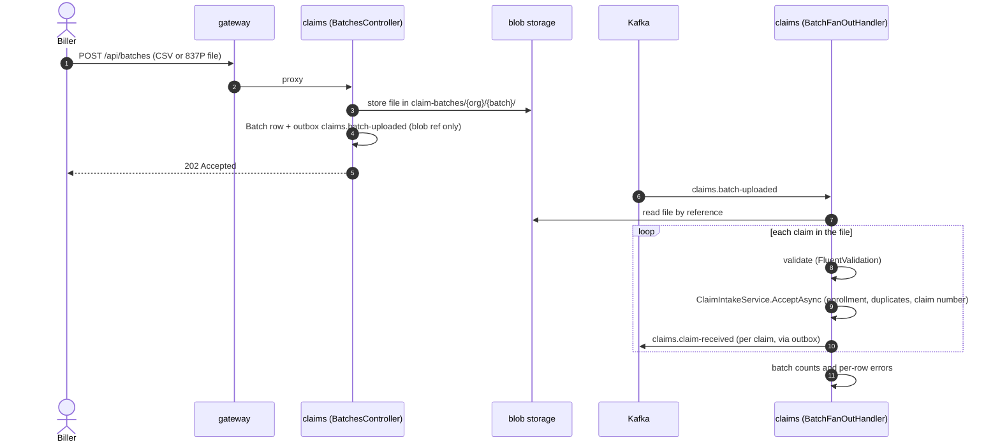
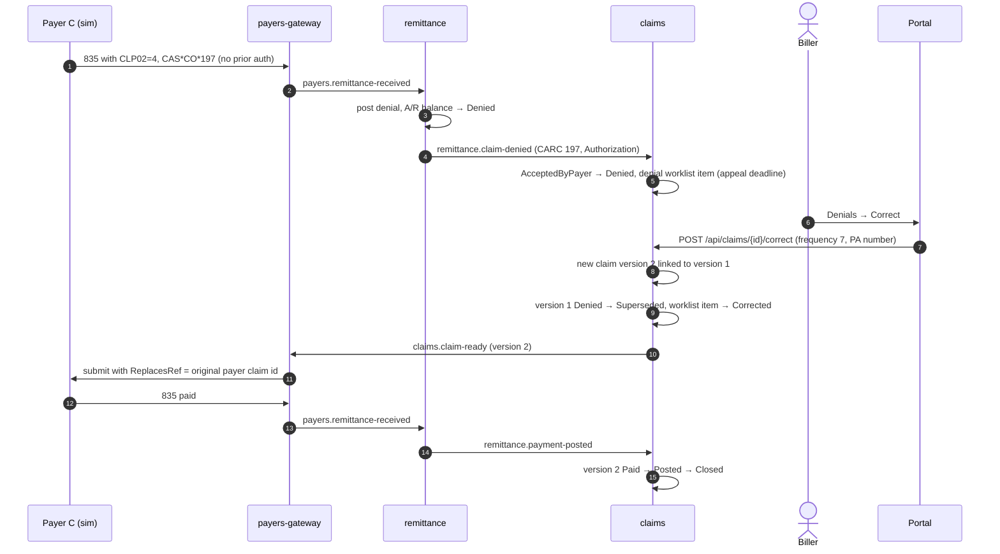
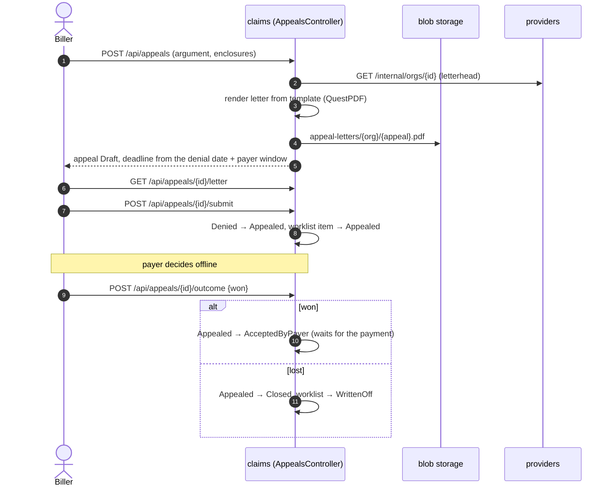
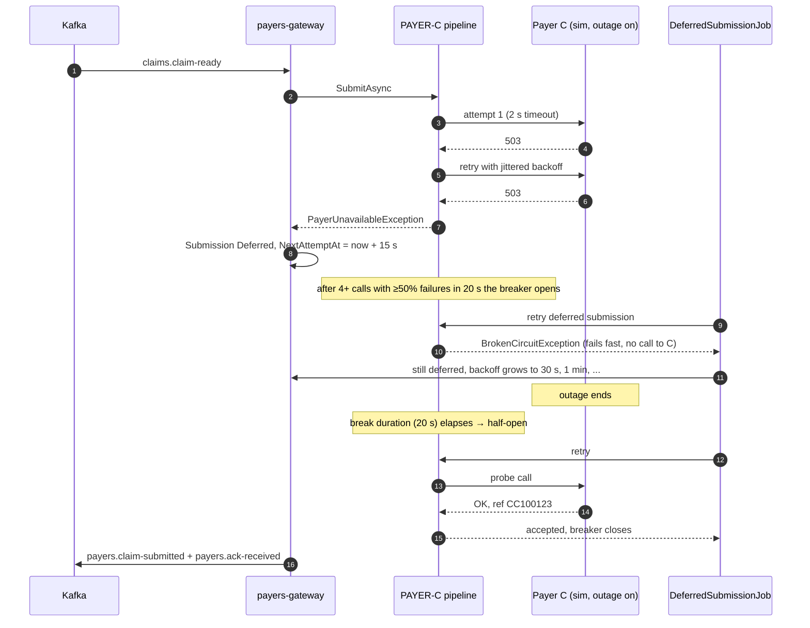

# How it works

This page follows a claim through the system end to end, then looks at the side paths: batch uploads, denials and
corrections, appeals, and what happens when a payer is down. Each diagram matches the code; class names are given so
you can jump straight to the implementation.

## 1. Portal claim to paid, posted and notified

A biller types a claim in the portal. While they type, the portal asks claims for a scrub preview (debounced, nothing
saved). On submit the claim is stored with its first status event and two outbox messages in one transaction. From
then on Kafka drives it: the scrub step, the hand-off to payers-gateway, the payer's answers, the remittance, and the
webhooks.

```mermaid
sequenceDiagram
    autonumber
    actor Biller
    participant Portal
    participant GW as gateway
    participant Claims as claims
    participant Scrub as scrubber
    participant Risk as denial-predictor
    participant PG as payers-gateway
    participant A as Payer A (sim)
    participant Remit as remittance
    participant Notif as notifications
    participant Hook as provider webhook

    Biller->>Portal: fill in claim
    Portal->>GW: POST /api/claims/scrub-preview (debounced)
    GW->>Claims: proxy
    Claims->>PG: POST /internal/eligibility (cached)
    Claims->>Scrub: gRPC Scrub(persist=false)
    Claims->>Risk: POST /internal/score (2 s timeout)
    Claims-->>Portal: edits, eligibility, risk + factors
    Biller->>Portal: Submit
    Portal->>GW: POST /api/claims
    GW->>Claims: proxy
    Claims->>Claims: save claim + history + outbox (one transaction)
    Claims-->>Portal: 201 Received
    Note over Claims: OutboxDispatcher publishes claims.claim-received
    Claims->>Claims: ScrubStepHandler: Received → Scrubbing
    Claims->>Scrub: gRPC Scrub(persist=true)
    Claims->>Risk: score for the record
    Claims->>Claims: ClaimProcessManager: Scrubbing → ReadyToSubmit, publish claims.claim-ready
    PG->>Claims: GET /internal/claims/{id}/submission (claim check)
    PG->>A: POST /payer-a/v1/claims (throttle, bulkhead, retry, breaker)
    A-->>PG: ACCEPTED, trackingId
    PG->>PG: publish payers.claim-submitted + payers.ack-received
    Claims->>Claims: Submitted → AcceptedByPayer
    Claims->>Notif: claims.status-changed
    Notif->>Hook: claim.accepted (HMAC signed)
    A->>PG: callback FINALIZED/PAID (X-Northwind-Token)
    PG->>Claims: payers.status-updated → AcceptedByPayer → Paid
    A->>A: write 835 to payer-a/outbound
    PG->>PG: PayerFilePollingJob picks up the 835, copies it to the remittances container
    PG->>Remit: payers.remittance-received (blob reference)
    Remit->>Remit: parse 835, post CLP, update A/R balance
    Remit->>Claims: remittance.payment-posted
    Claims->>Claims: Paid → Posted → Closed
    Claims->>Notif: claims.status-changed
    Notif->>Hook: claim.paid, remittance.posted
```

Points worth noticing:

- The claim never leaves the claims service with PHI on Kafka. `claims.claim-ready` carries only ids; payers-gateway
  pulls the full [`SubmissionDocument`](../src/shared/ClaimBridge.Contracts/Submission/SubmissionDocument.cs) over the
  internal API, and that release is audited (`phi.released-for-submission`).
- Every arrow out of claims is a status transition through
  [`ClaimLifecycle`](../src/services/claims/ClaimBridge.Claims/Domain/ClaimLifecycle.cs), and each one appends a row to
  the claim's immutable history and an outbox message in the same transaction.
- The risk score is optional. If the model service is slow the call times out after two seconds and the claim goes on
  without it.

## 2. Batch upload fan-out

A bad row is reported on the batch and does not stop the rest of the file. A malformed X12 file is rejected as a
whole with the parser's segment number in the message.

## 3. Denial, correction and resubmission

Corrections never edit a submitted claim. The replacement is a new row with `PreviousClaimId`, a higher `Version` and
frequency code 7; the original keeps its history and ends in `Superseded`. For a void (frequency 8) the original ends in
`Voided` and the payer reverses anything it paid.

## 4. Appeal

## 5. Payer C outage: circuit breaker, parking and recovery

The claim stays `ReadyToSubmit` while it is parked, so the claims service's acknowledgement timer has not started yet;
nothing is lost and nothing piles up in Kafka retry topics. The payer-health page shows the circuit as Open while this
happens, and Payer A and B keep flowing because each payer has its own pipeline and bulkhead.

## 6. When the payer goes quiet

If a submission is not acknowledged within the payer's SLA, the claims process manager's durable deadline fires
([`LifecycleTimeoutJob`](../src/services/claims/ClaimBridge.Claims/Lifecycle/LifecycleTimeoutJob.cs)): first a 276-style
status inquiry through payers-gateway, then one resubmission, and if that also goes unanswered the claim moves to
`Escalated` for the ops team. [claim-lifecycle.md](claim-lifecycle.md) has the timings and how to trigger it with the
simulator.
