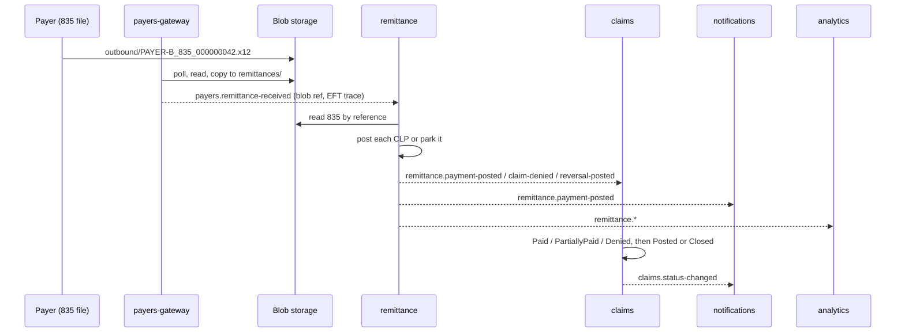

# Remittance and A/R

A payer pays in bulk: one EFT deposit and one 835 file covering many claims, each with its own mix of payment,
contractual write-off, patient responsibility and denial reasons. The remittance service turns that file into one
posting per claim, keeps the accounts receivable balance of every submitted claim, and parks anything it cannot post
for a person to look at.

## Choreography

Posting is a choreography rather than an orchestration: no service tells another what to do, each reacts to an event
and publishes its own.

The 835 itself never travels through Kafka. payers-gateway stores it and publishes a reference (the claim check
pattern), so a 2 MB remittance does not have to fit in a message and is not copied into every consumer.

## Posting one claim

[`RemittanceReceivedHandler`](../src/services/remittance/ClaimBridge.Remittance/Consumers/RemittanceReceivedHandler.cs)
reads the file once; if a `RemittanceFile` with the same id already exists, the event is a redelivery and is ignored.
An unreadable file is stored with status `Unreadable` and the parse error. Each CLP loop then goes to
[`PostingService`](../src/services/remittance/ClaimBridge.Remittance/Domain/PostingService.cs):

1. **Match.** The CLP's claim control number and the payer must match an `ExpectedClaim`. Remittance builds that
   list itself from `claims.status-changed` ([`ClaimStatusProjection`](../src/services/remittance/ClaimBridge.Remittance/Consumers/ClaimStatusProjection.cs)),
   and opens the A/R balance at the same moment the claim is submitted.
2. **Calculate.** [`PostingCalculator`](../src/services/remittance/ClaimBridge.Remittance/Domain/PostingCalculator.cs)
   sums the CAS adjustments by group code and checks the invariant

   `charge = paid + CO/PI adjustments + OA adjustments + patient responsibility`

   CLP05 (patient responsibility) wins over the sum of PR adjustments when a payer only sends one of them. Allowed is
   CLP's AMT if present, otherwise paid plus patient responsibility.
3. **Classify.**

   | Kind | When |
   |---|---|
   | `Reversal` | CLP02 = 22 (takeback of an earlier payment) |
   | `Denial` | CLP02 = 4, or nothing paid and nothing owed by the patient |
   | `PartialPayment` | something paid, but a CO/OA adjustment other than the contractual 45 and 253 remains |
   | `Payment` | everything else |

   The largest non-contractual adjustment is the primary denial reason; its CARC maps to a category (Eligibility,
   Authorization, Coding, Bundling, MedicalNecessity, TimelyFiling, Duplicate, ...) from
   [`adjustment-reasons.json`](../src/shared/ClaimBridge.Contracts/ReferenceData/adjustment-reasons.json), which holds
   the 22 CARCs and 8 RARCs this project uses, with short explanations written for it.
4. **Post and publish.** The `Posting` row, the balance update and the outbox message are saved in one transaction.

## Reconciliation queue

Two things send a CLP to the `Unmatched` table instead of failing the file:

- no expected claim with that number for that payer;
- the claim does not balance.

The first often fixes itself: an 835 can arrive before remittance has seen the claim's `Submitted` status.
[`ReconciliationRetryJob`](../src/services/remittance/ClaimBridge.Remittance/Jobs/ReconciliationRetryJob.cs) retries
those lines every two minutes. Whatever is left shows on the ops reconciliation screen, where staff can match a line
to a claim number (`POST /api/reconciliation/{id}/match`) or dismiss it with a note. The file's status is `Posted`
when every line matched and `PartiallyPosted` otherwise.

## A/R and ageing

Each submitted claim has a [`ClaimBalance`](../src/services/remittance/ClaimBridge.Remittance/Data/ClaimBalance.cs):
charge, paid, adjusted, patient responsibility and the payer outstanding amount
(`charge - paid - adjusted - patient responsibility`). Postings and reversals update it; a closed claim has nothing
outstanding.

[`Ageing`](../src/services/remittance/ClaimBridge.Remittance/Domain/Ageing.cs) buckets open and denied balances into
0-30, 31-60, 61-90 and 90+ days, counted from the submission date rather than the date of service, because that is
when the payer's clock starts. Days in A/R is outstanding divided by average daily charges over the last 90 days.

| Endpoint | Returns |
|---|---|
| `GET /api/ar/summary` | outstanding, ageing buckets and days in A/R for the caller's organisation (staff can pass `orgId`) |
| `GET /api/ar/open-claims` | open balances, oldest first |
| `GET /api/ar/snapshots` | the nightly snapshots for trend charts |

[`ArSnapshotJob`](../src/services/remittance/ClaimBridge.Remittance/Jobs/ArSnapshotJob.cs) writes one snapshot per
organisation and payer every night at 02:00 (`Jobs:ArSnapshotCron`). In Kubernetes the same job is triggered by a
CronJob that calls `POST /internal/jobs/ar-snapshot`, so it runs once even with several replicas.

## Remittance PDF

`GET /api/remittances/{id}/pdf` renders a provider-friendly remittance (payment, claims, adjustments with their
explanations) with QuestPDF ([`RemittancePdf`](../src/services/remittance/ClaimBridge.Remittance/Pdf/RemittancePdf.cs)),
under the QuestPDF Community licence.

## Denials worklist

When claims receives `remittance.claim-denied` (or a partial payment), it opens a `DenialWorkItem`
([`DenialWorklist`](../src/services/claims/ClaimBridge.Claims/Denials/DenialWorklist.cs)) with the CARC, category,
denied amount and the appeal deadline (Northwind 90 days, Bluepeak 180, Cascade 60). `GET /api/denials` filters it by
status, payer and category and also returns the items grouped by category, payer and age bucket. From there a user either corrects the claim (frequency 7, which
marks the item `Corrected`) or opens an appeal: `POST /api/appeals` creates a draft, `GET /api/appeals/{id}/letter`
renders the letter from a fixed template, and `submit` and `outcome` move it through `Submitted` to won or lost. A
payment that arrives for an appealed claim counts as a win.
